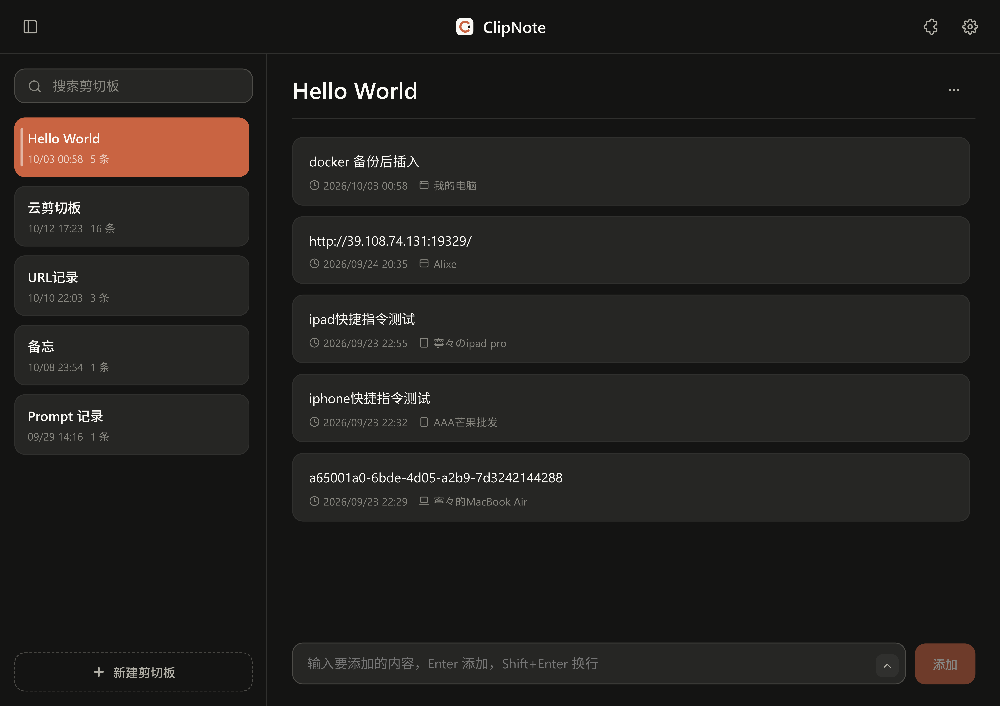

<h1 align="center">ClipNote</h1>

<p align="center">
  纯文本剪贴板的多设备实时同步服务
</p>

<p align="center">
  <a href="#快速部署">快速部署</a> ·
  <a href="#核心功能">核心功能</a> ·
  <a href="docs/SPEC.md">项目说明书</a>
</p>

<p align="center">
  
</p>

---

## 简介

ClipNote 让你在任意设备（桌面脚本、iOS 快捷指令、浏览器）上把一段文本存入剪贴板，其余所有设备**实时**看到最新内容，并可一键复制回本地。它面向个人跨设备文本流转场景，开箱即用、零运维。

> 原名 ClipVault，2026-10 更名为 ClipNote。旧数据（数据库文件、Docker 卷、浏览器设置）在升级时自动迁移，详见 [docs/DEPLOY.md](docs/DEPLOY.md) 第 7 节。

## 核心功能

- **多剪贴板**：像文件夹一样管理多个剪贴板。
- **实时同步**：多设备同步，断线自动重连并补齐期间缺失的数据。
- **条目管理**：新增、编辑、删除、复制，并可手动「检查重复」（按内容哈希分组）。
- **设备来源标记**：每条记录标注来源设备（iPhone / iPad / Mac / PC / Web），设备名可自定义。
- **插件扩展**：通过 `.CVT` 文字处理插件对剪贴板内容做自动化加工，处理结果可预览、可撤销。
- **安全鉴权**：所有接口与实时连接均需 API Key 校验，保障私有部署的数据安全。

## APPLE 设备接入

在 Web 端输入 API Key 即可直接使用。桌面脚本与 iOS 快捷指令通过标准 HTTP 接口写入文本，携带 `Authorization: Bearer <API_KEY>` 请求头即可，剪贴板 UUID 在 Web 端「编辑剪贴板」弹窗中查看。

iOS / iPadOS / macOS 用户可直接获取快捷指令，一键把剪切板内容写入 ClipNote：

<a href="https://www.icloud.com/shortcuts/99a3eb2586d04c1e9283fe5273534bc4">
  
</a>

完整 REST 端点、WebSocket 事件与错误码见 [docs/SPEC.md](docs/SPEC.md)。

## 插件系统

本项目的核心卖点，插件是 `.CVT` 纯文本文件，包含一段元数据与一个处理函数，经「插件管理」界面导入后存储在服务器，供所有设备共享。插件在浏览器沙箱中安全执行，处理结果提供「原文 / 结果」预览并支持单步撤销，同一时间启用一个插件。

规范详见 [docs/PLUGINS.md](docs/PLUGINS.md)，示例插件见 [extensions/](extensions/)。

## 快速部署

前置要求：Docker Engine 20.10+ 与 Docker Compose v2。

```bash
cp .env.example .env
# 编辑 .env：设置强随机 API_KEY（openssl rand -hex 32）
# 对外端口默认 31291，可用 CLIPNOTE_PORT 修改

docker compose up -d --build
# 中国大陆服务器使用专用版：
# docker compose -f docker-compose.cn.yml up -d --build
```

更多信息详见 [release](https://github.com/Syrnaxei/ClipNote/releases/tag/v1.2.0) 。

浏览器打开 `http://<服务器IP>:31291`，输入 API Key 即可使用。数据备份、恢复、升级与常见问题见 [docs/DEPLOY.md](docs/DEPLOY.md)。

## 技术架构

采用 Caddy（静态托管 + 反向代理）+ Node.js 服务 + SQLite（WAL 模式）的组合，通过 Docker Compose 多阶段构建一键部署。

```
 桌面端脚本 ────────►  Caddy  ────►  server (Node.js)
 iOS 快捷指令 ──────►  :80         Express + ws + better-sqlite3
 浏览器 ◄──────────►  静态文件      │
                                 SQLite 卷（WAL 模式）
```

| 层 | 技术 |
|----|------|
| Server | Node.js 22 + TypeScript + Express 5 + ws + better-sqlite3 + zod |
| Web | React 19 + Vite + TypeScript |
| 代理 | Caddy（静态托管 + `/api/*`、`/ws` 反代） |
| 部署 | Docker Compose 多阶段构建 |

本地开发一键启动前后端环境：

```bash
./scripts/dev.sh   # 详见 docs/DEV.md
```

## 文档

- [docs/SPEC.md](docs/SPEC.md) — 项目说明书（架构 / 数据模型 / API / 决策记录）
- [docs/DEPLOY.md](docs/DEPLOY.md) — 部署、备份、升级与迁移
- [docs/PLUGINS.md](docs/PLUGINS.md) — 插件规范（.CVT）
- [docs/DEV.md](docs/DEV.md) — 本地开发指南
- [docs/DESIGN.md](docs/DESIGN.md) — 前端设计系统

## License

[MIT](LICENSE)
